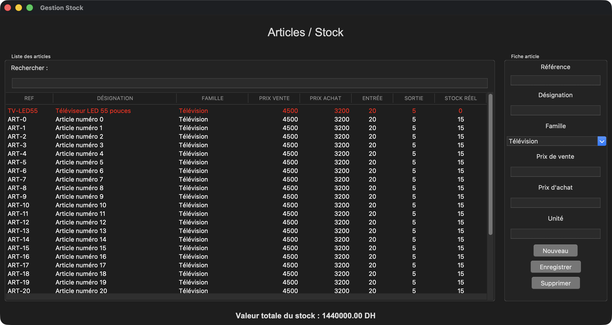

# Stockflow

**Logiciel de gestion de stock pour un magasin de vente d'électronique**

Projet réalisé dans le cadre du module encadré par **Pr. Mustapha Hain**
ENSAM Casablanca, filière IAGI-1, année 2026 – 2027.



## Le projet

Stockflow suit le parcours de la marchandise dans un magasin d'électronique :

1. **Réceptions** : le magasin achète ses articles à des fournisseurs. Chaque arrivée fait entrer les quantités en stock et met à jour le prix d'achat.
2. **Livraisons** : le magasin vend ses articles à ses clients. Chaque vente fait sortir les quantités du stock, et elle est refusée si le stock ne suffit pas.
3. **Articles / Stock** : cet écran montre pour chaque article ce qui est entré, ce qui est sorti et le stock réel. Il affiche en rouge les articles en rupture et calcule la valeur du stock.
4. **Clients** et **Fournisseurs** : ces écrans permettent d'ajouter, de modifier et de rechercher les clients et les fournisseurs.

L'application est écrite en **Python** avec **tkinter**. Les données sont enregistrées dans une base **SQLite** (`stockflow.db`).

## Lancer l'application

Il faut Python 3. Aucune bibliothèque externe n'est nécessaire.

```bash
python3 main.py
```

Le menu principal ouvre chaque fenêtre. La base `stockflow.db` est créée automatiquement au premier lancement.

## Organisation du code

| Fichier | Rôle |
|---|---|
| `main.py` | Menu principal |
| `articles.py` | Fenêtre Articles / Stock (interface 1) |
| `clients.py`, `fournisseurs.py` | Fenêtres Clients et Fournisseurs (interface 2) |
| `reception.py` | Fenêtre Réceptions (interface 3) |
| `livraisons.py` | Fenêtre Livraisons (interface 4) |
| `database.py` | Connexion SQLite et création des tables |
| `articles_db.py`, `clients_db.py`, `fournisseurs_db.py`, `mouvements_db.py` | Requêtes SQL de chaque partie |

## Équipe

| Fenêtre | Interface | Base de données |
|---|---|---|
| 1. Articles / Stock | Abouelfadile Nassim | Louriki Reda |
| 2. Clients et Fournisseurs | Mellati Mohamed Amine | Louriki Reda |
| 3. Réceptions | Abouelfadile Nassim | Louriki Reda |
| 4. Livraisons | Mellati Mohamed Amine | Louriki Reda |

## Rapport

Le rapport complet se trouve ici : [rapport/Rapport_Stockflow.pdf](rapport/Rapport_Stockflow.pdf).
Il présente chaque fenêtre avec des captures de l'application et le code qui produit chaque partie.
